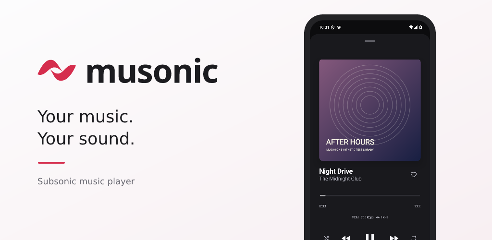
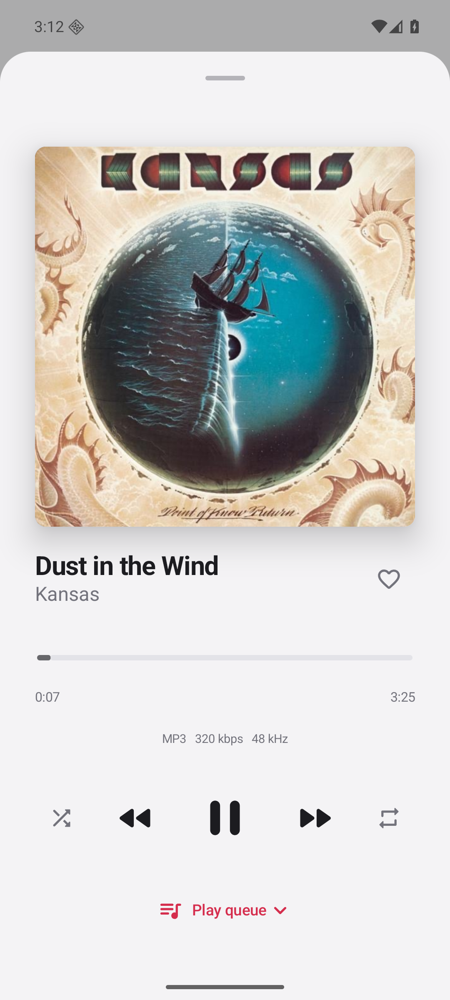
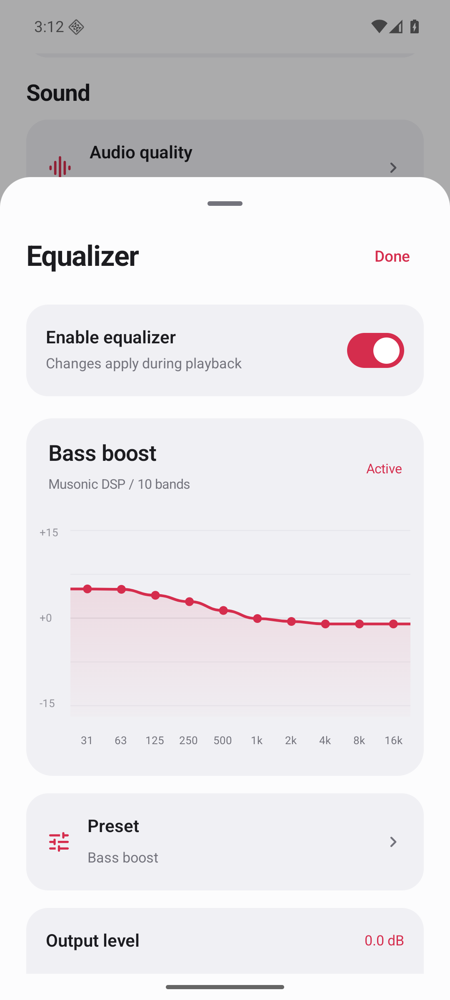

Your music. Your server. Your sound.

A free Android player for Subsonic and OpenSubsonic music libraries.

<a href="https://github.com/ljaehwan/Musonic-releases/releases/latest">Download the latest APK</a> · <a href="https://github.com/ljaehwan/Musonic-android">Source code</a> · <a href="https://ljaehwan.github.io/Musonic-releases/privacy/">Privacy policy</a> · <a href="https://github.com/ljaehwan/Musonic-android/issues/new/choose">Report a bug or suggest a feature</a>

## Make your library feel at home

Musonic connects directly to a music server you choose. Browse albums and artists, search your collection, revisit recent listens, and keep favorites close.

- **Shape your sound:** in-app 10-band equalizer, presets, preamp, left/right channel gain, and loudness compensation.
- **Choose streaming quality:** original files or MP3 quality options, depending on your server’s transcoding support.
- **Keep listening:** background playback and Android media controls.
- **Make it yours:** light and dark appearance; Korean, English, Japanese, Simplified Chinese, and Spanish.
- **Keep control of your connection:** encrypted on-device credentials, artwork caching, and no advertising or analytics SDK.

 

Musonic does not provide songs, a music subscription, or a server account. Bring a compatible Subsonic/OpenSubsonic server and music you have permission to access. Server-specific features can vary. Android Auto integration is under development and still needs real-car verification.

## Install from GitHub

1. Open [Releases](https://github.com/ljaehwan/Musonic-releases/releases/latest) and download the attached Musonic APK.
2. Install it on Android 8.0 or newer, approving Android’s installation prompt.
3. Enter your music-server URL and account details. HTTPS is recommended; the direct build offers explicit HTTP opt-in for servers that require it.

The GitHub build checks this release repository for updates. You can download and install an available update from the app; Android asks you to confirm installation. Existing GitHub releases retain their update-compatible signing certificate.

**Google Play:** registration is in progress. There is no published Play listing yet. The planned Play build receives updates through Google Play and requires HTTPS. Its signing certificate will differ from existing GitHub APKs, so switching between these distributions requires uninstalling and reinstalling. This removes local connection/settings/history data; your server library remains on the server. Keep using the same installation channel for normal updates.

## Help Musonic improve

If Musonic is useful to you, a **star on [Musonic-android](https://github.com/ljaehwan/Musonic-android)** helps others discover the project. It is optional; features and support do not depend on starring the repository.

Bug reports, feature ideas, and translation suggestions are welcome in [Issues](https://github.com/ljaehwan/Musonic-android/issues/new/choose). For private support or privacy requests, email **hwandevlog@gmail.com**. Never post passwords, API keys, or server URLs containing authentication parameters in a public issue.

This repository hosts APK releases and the privacy policy. The application source is available under the MIT license in [Musonic-android](https://github.com/ljaehwan/Musonic-android), with build instructions, contribution guidelines and daily star history. The delivery branch remains reserved for release automation; existing APK updates continue to use this repository.

---

## 한국어 안내

Musonic은 Subsonic/OpenSubsonic 호환 서버에 연결하는 **무료·광고 없는 Android 음악 앱**입니다. 앨범·아티스트 탐색, 검색, 좋아요, 최근 재생, 앱 내부 10밴드 이퀄라이저와 음질 설정을 제공합니다. 음악 서버와 계정은 별도로 준비해야 합니다.

[최신 APK](https://github.com/ljaehwan/Musonic-releases/releases/latest)를 설치한 뒤 서버 주소와 계정을 입력하세요. GitHub 설치본은 앱에서 업데이트를 확인·다운로드하며, 설치는 Android 확인 화면에서 승인합니다. Play 버전은 등록 준비 중이며 아직 스토어에 공개되지 않았습니다. 두 배포본은 서명이 달라 전환 시 재설치가 필요합니다.

소스는 [Musonic-android](https://github.com/ljaehwan/Musonic-android)에 MIT 라이선스로 공개되어 있습니다. 앱이 마음에 드셨다면 소스 저장소에 별표를 남겨주세요. 불편한 점이나 아이디어, 번역 제안은 [Issues](https://github.com/ljaehwan/Musonic-android/issues/new/choose)로 받을게요. 문의는 **hwandevlog@gmail.com**, 개인정보 처리와 삭제 방법은 [개인정보처리방침](https://ljaehwan.github.io/Musonic-releases/privacy/)에서 확인하실 수 있습니다.
